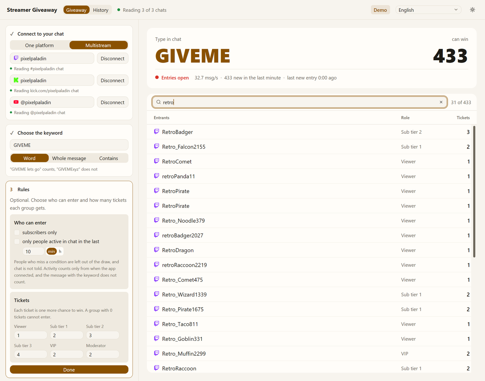
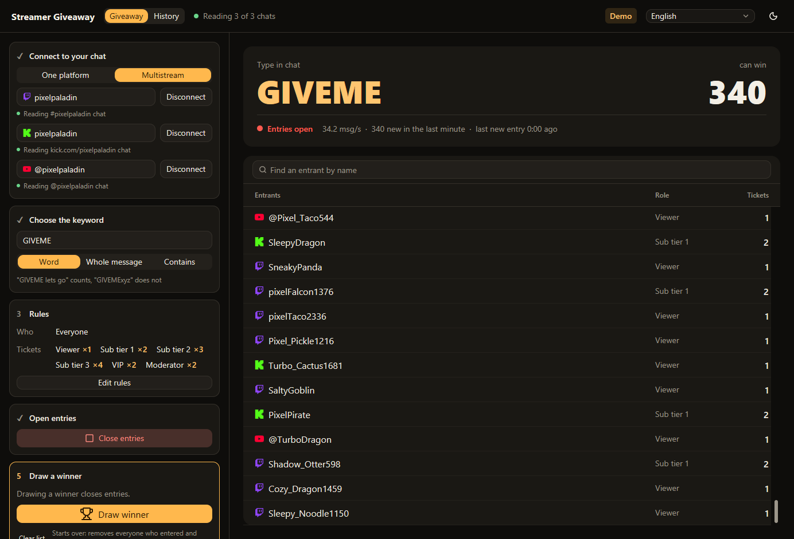

# Streamer Giveaway

A free desktop app for chat giveaways on Twitch, Kick and YouTube. Viewers enter by typing a keyword
in chat, the app counts each person once, and you draw a winner live on stream. You don't need a bot account, a
login or a browser source.

**[Download for Windows](https://github.com/vengex-org/streamer-giveaway/releases/latest)**


## Why a desktop app

- Chat goes straight from Twitch, Kick or YouTube to your PC. An entry shows up the moment its
  message arrives, with no web dashboard or cloud bot in between.
- If you multistream, one giveaway can take entries from all three chats at once.
- Setup takes a minute: type your channel name, pick a keyword, open entries.
- You can rehearse before going live. "Try demo" opens a second window with a simulated chat.

## Features

- The app reads your chat anonymously after you type your channel name (on YouTube, the stream
  link or the channel's @handle). It never writes to chat. You choose one platform, or
  Multistream to connect several chats; each entrant then shows the logo of the chat they came
  from, and an account on one platform never counts as someone else's on another.
- Each person enters once, however many times they post. The keyword can be required as a word, as
  the whole message, or anywhere in the message.
- Subs (tier 1, 2 and 3), VIPs and moderators can get more tickets than regular viewers. A group
  with 0 tickets cannot enter. Subscribers show with the channel's own sub badge. Kick subs and
  YouTube members count as tier 1, since those platforms have no tiers.
- A search box above the list finds an entrant by a rough name, so you can tell someone they are in.
- You can let in only subscribers, or only people who chatted in the last few minutes or hours, so
  people who show up just for the giveaway don't count.
- The window is built to be captured on stream: a large keyword and entrant count, a short reveal
  when you draw, and a winner panel with a stopwatch that stops when the winner answers in chat.
- While entries are open, a line under the counters shows chat messages per second, new entrants
  in the last minute and how long ago the last one came in, so you can see when entries dry up.
  When entries close, the app saves a CSV log with the time and kind of every message (no message
  text) and the drawn winners. The History page lists past giveaways from these logs: how long
  entries were open, entrants, messages, how fast 90 % of the entries came in, and the winners.
- Five numbered steps with a short hint guide first-time users. The next step is highlighted, and
  a button you cannot press yet says why. The Rules step always shows who can enter and how many
  tickets each group gets, so you don't have to look for them.
- There is a dark and a light theme, and the app speaks English, Slovak, Czech and Spanish. Both
  follow your system settings until you pick one in the header, and "Auto" or "System" goes back
  to that.

| Entries coming in (8000-viewer demo) | Winner answered | Rules and search, light theme |
|---|---|---|
|  |  |  |

Multistream: Twitch, Kick and YouTube chats feed one giveaway, and each entrant shows the logo of
their chat.



## Try it without a stream

Press "Try demo" in the top bar. A second window opens with a simulated chat, so you can run a
whole giveaway without going live. Your real settings and channel stay as they are.

From a terminal the same window starts with:

```sh
cargo run --release -- --demo
```

Demo mode replaces the real chats with a simulated one on `pixelpaladin`: 6000 messages over three
minutes from about 2400 chatters, most of them typing `GIVEME`. The drawn winner answers a few
seconds after the draw. Demo settings are stored separately and never touch your real ones.

To rehearse a big giveaway, give the audience size instead:

```sh
cargo run --release -- --demo-viewers=8000
```

By default 40 % of the viewers enter, half of them within 20 seconds of the announcement, with
15 other chat messages per second around them. `--demo-share=0.6`, `--demo-half-life=45`,
`--demo-chat=30` and `--demo-cap=100` (Twitch delivering at most 100 messages per second) change
that. These defaults are guesses; the CSV log of a real giveaway shows the real values.

## Download

Windows builds are on the [releases page](https://github.com/vengex-org/streamer-giveaway/releases).
The .exe is not signed, so Windows SmartScreen may warn before the first start ("More info", then
"Run anyway").

## Privacy

The app sends nothing anywhere unless you ask it to. When you connect a chat it reads it
anonymously, without your login:

- Twitch: the chat over Twitch's IRC, and the channel's subscriber badge pictures from
  [api.ivr.fi](https://api.ivr.fi), a community Twitch API.
- Kick: the channel's public page data and a guest connection to its chat, the same way kick.com
  loads them in a browser.
- YouTube: the stream's public chat page, the same way youtube.com shows it in a browser. No API
  key is needed.

These requests carry only the channel name or stream link. Kick and YouTube chat use the sites' own
web interfaces, which can change; if one breaks, its chat shows the reason and the others keep
running. Settings and giveaway logs stay on your computer.

## Build and run

You need [Rust](https://rustup.rs) (stable). On Windows also the Visual Studio C++ build tools and a
Windows SDK; on Linux the GPUI system packages (see the
[GPUI docs](https://github.com/zed-industries/zed/tree/main/crates/gpui)).

```sh
git clone https://github.com/vengex-org/streamer-giveaway.git
cd streamer-giveaway
cargo run --release
```

The first build takes several minutes.

## How to run a giveaway

1. Pick one platform or Multistream, type your channel name (or YouTube stream link) and press
   Connect.
2. Type the word viewers should write and press Enter.
3. Check the rules. "Edit rules" lets you limit who can enter and give subs, VIPs or moderators
   more tickets.
4. Press "Open entries" and tell chat the keyword.
5. Press "Draw winner". Entries close, names flash for a moment, and then the winner shows with a
   stopwatch. When they write in chat, their messages appear in the panel. "Draw another" picks
   someone else, since a winner cannot win twice. "Clear list" starts over.

Settings are saved to `%APPDATA%\streamer-giveaway\config\config.toml` on Windows and to the
platform's config folder elsewhere. Giveaway logs go to `%APPDATA%\streamer-giveaway\data\logs`.
Entrants are not saved.

## Development

```sh
cargo test
cargo clippy --all-targets -- -D warnings
cargo fmt --check
```

- `src/domain` holds the giveaway rules, with no UI or IO.
- `src/chat/` reads the chats on one thread, a task per platform (`twitch.rs`, `kick.rs`,
  `youtube.rs`); `src/demo.rs` is the simulated chat.
- `src/ui/` is the window: `steps.rs` (left column), `stage.rs` (the part viewers see),
  `header.rs`, `palette.rs` (colors for both themes).
- `cargo run --release --example chat_rate -- <channel> 60` measures a live chat for 60 seconds:
  messages per second, peak and unique chatters. `<channel>` is a Twitch login, `kick:<name>` or
  `youtube:<link or @handle>`. `cargo run --release --example raffle_sim` prints
  how long giveaways take for several audience sizes and delivery caps.
- Texts live in `locales/app.toml`. A test fails when a language is missing or when UI code passes
  text that is not translated.

Built with [GPUI](https://gpui.rs) and [gpui-kit](https://github.com/longbridge/gpui-kit).

## License

[MIT](LICENSE)
