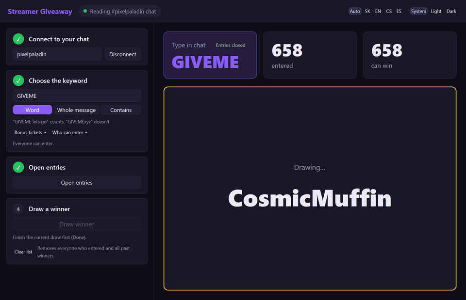
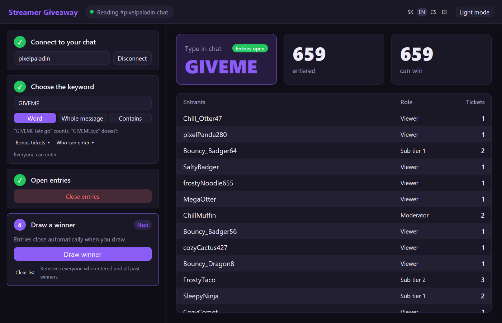
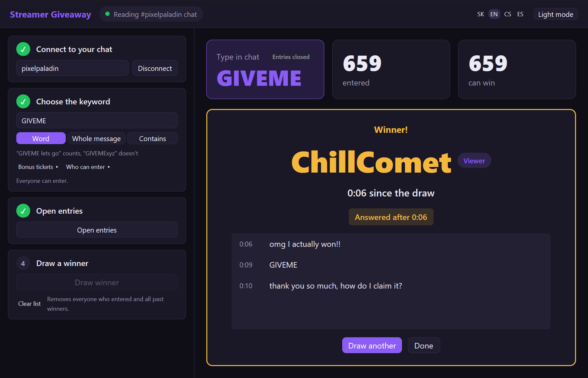
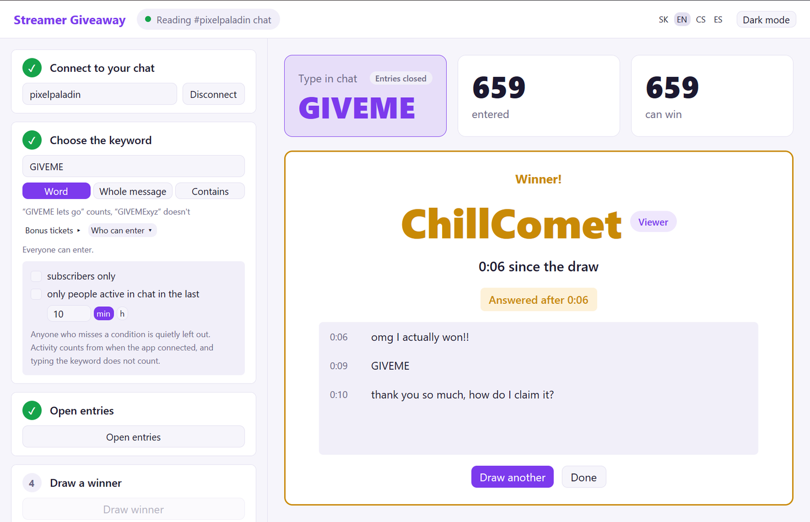

# Streamer Giveaway

A desktop app for Twitch chat giveaways. Viewers enter by typing a keyword in chat, the app counts
each person once, and you draw a winner on stream. You don't need a bot account, a login or a
browser source.



## Features

- The app reads your chat anonymously after you type your channel name. It never writes to chat.
- Each person enters once, however many times they post. The keyword can be required as a word, as
  the whole message, or anywhere in the message.
- Subs (tier 1, 2 and 3), VIPs and moderators can get more tickets than regular viewers. A group
  with 0 tickets cannot enter.
- You can let in only subscribers, or only people who chatted in the last few minutes or hours, so
  people who show up just for the giveaway don't count.
- The window is built to be captured on stream: a large keyword and entrant count, a short reveal
  when you draw, and a winner panel with a stopwatch that stops when the winner answers in chat.
- Four numbered steps with a short hint guide first-time users, and the next step is highlighted.
- There is a dark and a light theme, and the app speaks English, Slovak, Czech and Spanish. Both
  follow your system settings until you pick one.

| Entries coming in | Winner answered | Entry conditions, light theme |
|---|---|---|
|  |  |  |

## Try it without a stream

```sh
cargo run --release -- --demo
```

Demo mode replaces Twitch with a simulated chat on `#pixelpaladin`: 6000 messages over three
minutes from about 2400 chatters, most of them typing `GIVEME`. The drawn winner answers a few
seconds after the draw. Demo settings are stored separately and never touch your real ones.

## Build and run

You need [Rust](https://rustup.rs) (stable). On Windows also the Visual Studio C++ build tools and a
Windows SDK; on Linux the GPUI system packages (see the
[GPUI docs](https://github.com/zed-industries/zed/tree/main/crates/gpui)).

```sh
git clone https://github.com/vengex-org/streamer-giveaway.git
cd streamer-giveaway
cargo run --release
```

The first build takes several minutes.

## How to run a giveaway

1. Type your Twitch channel name and press Connect.
2. Type the word viewers should write and press Enter. Open "Bonus tickets" or "Who can enter" if
   you need them.
3. Press "Open entries" and tell chat the keyword.
4. Press "Draw winner". Entries close, names flash for a moment, and then the winner shows with a
   stopwatch. When they write in chat, their messages appear in the panel. "Draw another" picks
   someone else, since a winner cannot win twice. "Clear list" starts over.

Settings are saved to `%APPDATA%\streamer-giveaway\config\config.toml` on Windows and to the
platform's config folder elsewhere. Entrants are not saved.

## Development

```sh
cargo test
cargo clippy --all-targets -- -D warnings
cargo fmt --check
```

- `src/domain` holds the giveaway rules, with no UI or IO.
- `src/chat.rs` reads Twitch chat on its own thread; `src/demo.rs` is the simulated chat.
- `src/ui/` is the window: `steps.rs` (left column), `stage.rs` (the part viewers see),
  `header.rs`, `palette.rs` (colors for both themes).
- Texts live in `locales/app.toml`. A test fails when a language is missing or when UI code passes
  text that is not translated.

Built with [GPUI](https://gpui.rs) and [gpui-kit](https://github.com/longbridge/gpui-kit).

## License

[MIT](LICENSE)
